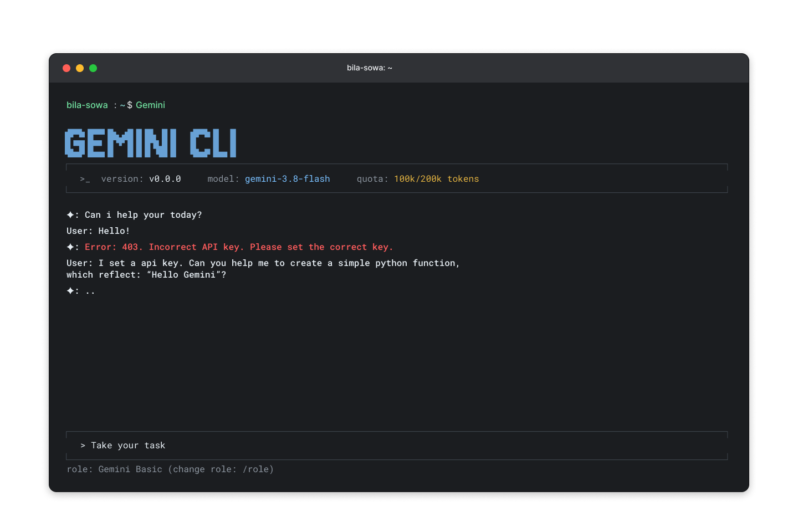
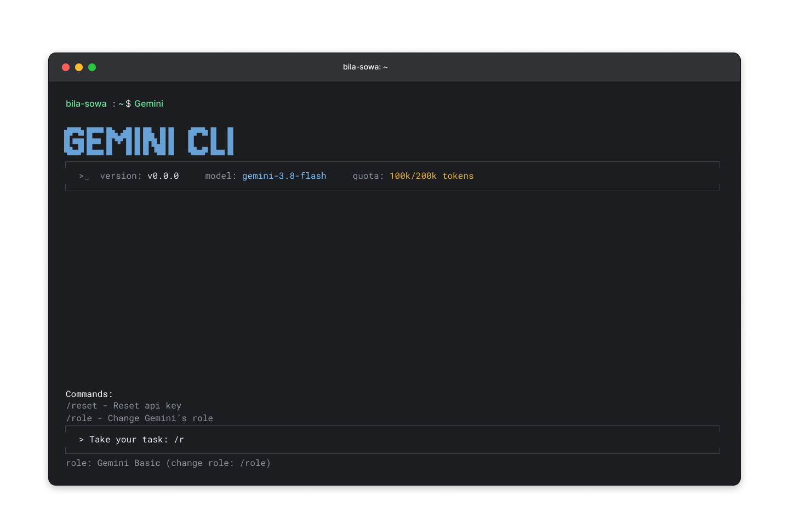
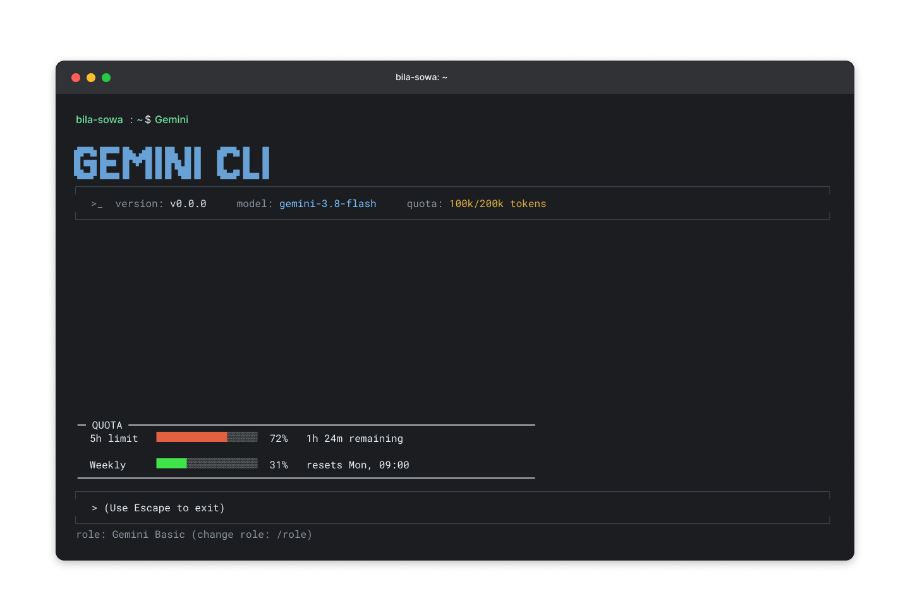
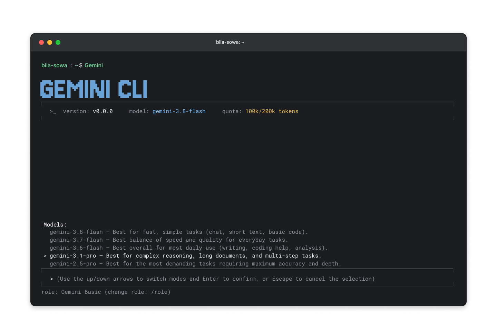
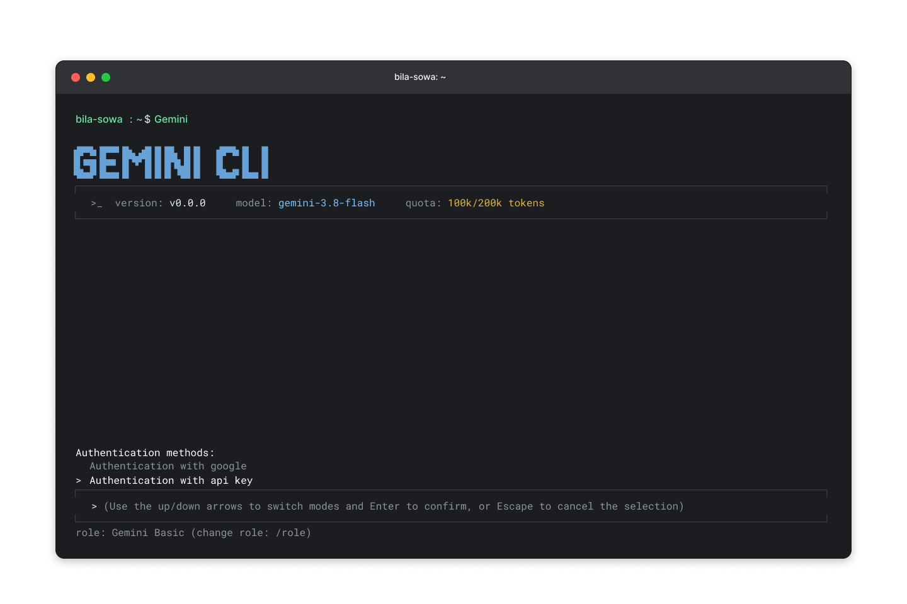
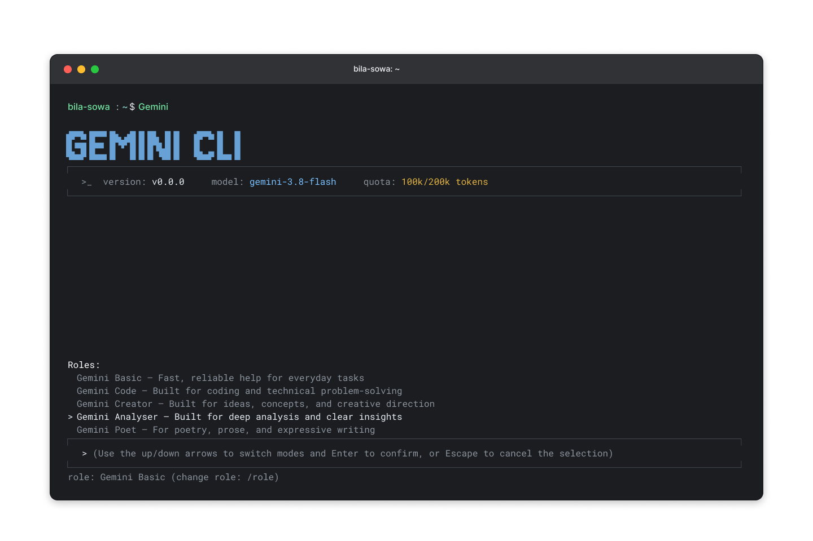

<div align="center">
  

  <h1>Gemini CLI</h1>

  <p><strong>A Gemini-first command-line agent for everyday work.</strong></p>

  <p>
    <a href="#about">About</a> ·
    <a href="#quick-start">Quick Start</a> ·
    <a href="#highlights">Highlights</a> ·
    <a href="#demo">Demo</a> ·
    <a href="./documentation/architecture.md">Architecture</a> ·
    <a href="#license">License</a>
  </p>
</div>

> [!NOTE]
> **Project status:** The core agent runtime and terminal UI are implemented
> (phases 0–8). MCP and RAG are planned, and the package is not yet published
> on PyPI. The screenshots below are interface concepts; visuals and commands
> may change as implementation progresses.

## About

Gemini CLI is an early-stage, Gemini-powered command-line agent designed to be
a flexible daily companion for coding, research, writing, analysis,
automation, and project work. Its goal is to bring model interaction, local
tools, project context, and external integrations into one focused terminal
workflow.

Instead of acting only as a chat client, Gemini CLI is designed around an
agent loop: understand the task, choose an action, use an approved tool,
observe the result, and continue until the task is complete. The same core is
intended to support both an interactive terminal interface and script-friendly
one-shot commands.

The proposed modular architecture is documented in
[Gemini Agent Architecture](./documentation/architecture.md).

### Why it was created

Gemini CLI was started for two reasons:

1. **To complement existing tools.** Coding-focused assistants such as Claude
   Code are excellent at software workflows. This project explores a broader
   daily assistant that can also support research, writing, project knowledge,
   web tasks, and custom integrations without leaving the terminal.
2. **To learn by building.** The project is a practical environment for
   studying LLM agents, tool calling, streaming, context management, MCP,
   retrieval, authentication, sandboxing, and production-oriented Python
   architecture.

It is not intended to replace every specialized tool. The aim is to provide a
single, extensible workspace that connects them when a task benefits from an
AI agent.

### What makes it different

The intended distinction is the combination of product focus and architecture:

- **Built for daily work, not one narrow workflow.** Coding, research,
  analysis, creative work, and automation share the same interface.
- **Gemini-first model experience.** Model selection, usage information,
  bounded retries, and controlled model fallback are treated as first-class
  concerns.
- **Interactive and scriptable.** A rich terminal conversation and a
  non-interactive command use the same agent runtime.
- **Role-based assistance.** Users can switch between focused profiles such
  as Basic, Code, Creator, Analyser, and Poet.
- **One tool system.** Built-in capabilities and tools discovered through MCP
  are exposed through a common validated registry.
- **Safety at the execution boundary.** Sensitive actions are designed to use
  explicit approval, restricted paths, timeouts, and replaceable sandbox
  backends.
- **Project-aware behavior.** Repository instructions such as `GEMINI.md` and
  `AGENTS.md` can guide the agent without overriding security controls.
- **Transparent, learning-friendly design.** Components are separated so the
  agent loop, model adapter, tools, security layer, and UI can be understood
  and tested independently.

## Quick Start

Requires Python 3.11+.

For local work:

```bash
uv sync --all-extras
uv run gemini-cli-py login
uv run gemini-cli-py chat
```

For a single non-interactive request:

```bash
uv run gemini-cli-py run "Summarize this repository"
```

Copy `.env.example` to `.env` for local configuration, and
`GEMINI.md.example` to `GEMINI.md` for project-specific instructions.

### Without uv

After the package is published on PyPI:

```bash
pipx install gemini-cli-py
gemini-cli-py chat
```

From a local checkout:

```bash
python -m venv .venv
source .venv/bin/activate
pip install .
gemini-cli-py chat
```

`python -m gemini_cli chat` also works once the package is installed.

## Highlights

- **Interactive TUI.** Full-screen Textual UI with streaming Markdown, themes,
  a context-window panel, and inline activity for thoughts, tools, and command
  output. Select text to copy it; press `Esc` to stop a response.
- **Gemini-first runtime.** Model registry, bounded retries, fallback, custom
  models, and streaming responses.
- **One tool system.** Filesystem, shell, web, and code-search tools behind a
  validated registry, with fail-closed approvals and a subprocess or Docker
  sandbox.
- **Project-aware.** Typed settings, `GEMINI.md`/`AGENTS.md` context, assistant
  roles, slash commands, and persisted model/theme choices.
- **Scriptable.** The same agent runtime powers `chat` and one-shot `run`.

## Demo

The following early interface mockups illustrate the intended terminal
experience. Visuals and commands may change as implementation progresses.





<table>
  <tr>
    <td width="50%" align="center">
      <strong>Context overview</strong>
    </td>
    <td width="50%" align="center">
      <strong>Model selection</strong>
    </td>
  </tr>
  <tr>
    <td>
      
    </td>
    <td>
      
    </td>
  </tr>
  <tr>
    <td width="50%" align="center">
      <strong>Authentication options</strong>
    </td>
    <td width="50%" align="center">
      <strong>Assistant roles</strong>
    </td>
  </tr>
  <tr>
    <td>
      
    </td>
    <td>
      
    </td>
  </tr>
</table>

## Stack

| Area                    | Technology                              |
| ----------------------- | --------------------------------------- |
| Runtime                 | Python 3.11+                            |
| Model API               | Gemini through `google-genai`           |
| CLI                     | Typer                                   |
| Terminal UI             | Textual                                 |
| Validation and settings | Pydantic and Pydantic Settings          |
| Prompt templates        | Jinja                                   |
| Tool interoperability   | MCP over stdio and SSE (planned)        |
| Isolation               | Docker or a resource-limited subprocess |
| Credential storage      | Operating system keyring                |
| Packaging               | `pyproject.toml` and `uv`               |
| Testing and quality     | pytest, Ruff, and mypy                  |

## Documentation

- [Architecture](./documentation/architecture.md) — package layout, runtime
  flows, and design decisions.
- [Development](./documentation/development.md) — setup, quality gates, and CI.
- [Tools and sandbox](./documentation/tools.md) — tool contract and built-in
  tool behavior.
- [Implementation plan](./documentation/plan.md) — historical phase plan.

## License

This project is licensed under the [Apache License 2.0](./LICENSE).
